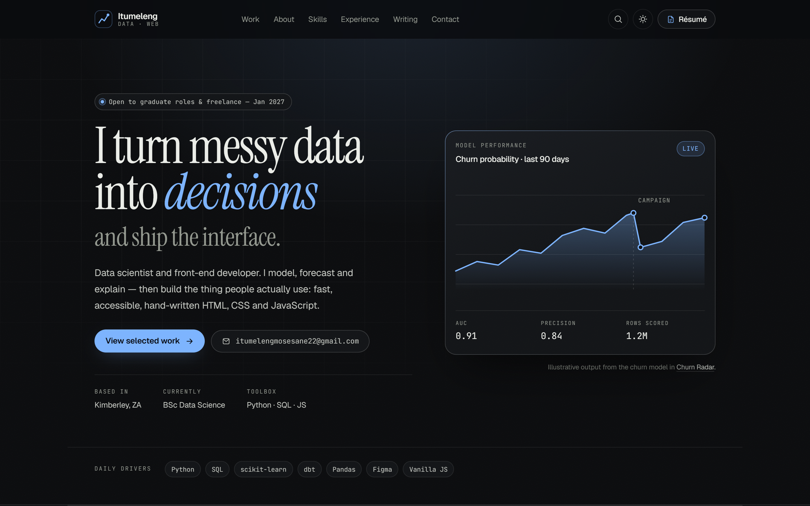

# Itumeleng — Data Scientist & Front-End Developer

A modern, hand-built portfolio for a data scientist who also writes HTML, CSS and JavaScript.
No framework, no build step, no tracking — one HTML file, one stylesheet, one script.



---

## What's inside

| Section | What it does |
|---|---|
| Hero | Positioning line, live model-performance chart (inline SVG), copy-email button, availability status |
| Stats band | Four headline numbers with count-up animation |
| Selected work | Six projects, filterable by discipline, filter state kept in the URL |
| About | Bio, working principles, profile card, pull quote |
| Skills | Three columns of tooling with proficiency meters plus a secondary "also in the bag" list |
| Experience | Timeline of roles and study, with metrics |
| Writing | Three note cards |
| Testimonials | Three short quotes with attribution |
| Contact | Validated form (inline errors, focus management, honeypot), email + social links |
| Footer | Navigation, colophon, back-to-top |

### Interactive details

- **Résumé in the header** — always visible, at every width (icon-only on narrow phones), linking to the printable one-pager.
- **Light / dark theme** — follows the OS on first visit, remembers your choice, no flash on load. Shareable via `?theme=light` or `?theme=dark`.
- **Command palette** — `Ctrl`/`Cmd` + `K`, type to filter, arrow keys to move, `Enter` to open.
- **Project filter** — syncs to `?filter=ml|analytics|frontend`, works with the back button.
- **Copy email** — clipboard API with a fallback and a toast confirmation.
- **Scrollspy** — current section highlighted in the nav; reading-progress bar in the header.
- **Reveal on scroll** — intersections only, disabled under `prefers-reduced-motion`.
- **Contact form** — validates on blur and on submit, focuses the first invalid field, announces status to screen readers, then opens a pre-filled email.

---

## Structure

```text
PORTFOLIO/
├── index.html                   # the portfolio
├── resume.html                  # printable one-page résumé
├── 404.html                     # custom error page
├── assets/
│   ├── css/styles.css           # design system + all layout
│   ├── js/main.js               # all behaviour, no dependencies
│   ├── img/favicon.svg
│   ├── img/og.svg               # social share card (1200×630)
│   └── itumeleng-resume.txt     # plain-text résumé for ATS uploads
├── docs/screenshots/            # reference renders
├── site.webmanifest
├── robots.txt
├── sitemap.xml
├── .htmlvalidate.json
└── README.md
```

---

## Run it locally

The site is static, so any file server works:

```bash
# Python
python -m http.server 4173

# or Node
npx serve .
```

Then open <http://localhost:4173>.

Opening `index.html` directly from disk also works, except the clipboard API and form styling
prefer a real origin.

---

## Make it yours

| Want to change | Where |
|---|---|
| Name, copy, projects, timeline | `index.html` (all content is plain markup) |
| Accent colour and theme | `assets/css/styles.css` → the `--accent*` tokens in `:root` and `[data-theme="light"]` |
| Fonts | The Google Fonts `<link>` in each page + `--font-*` tokens |
| Résumé text | `assets/itumeleng-resume.txt` and `resume.html` |
| Social links | `href`s in the contact section and footer (`rel="me"` is already set) |
| Canonical URL, OG image URL, sitemap | `index.html` `<head>`, `sitemap.xml`, `robots.txt` |
| Form endpoint | `assets/js/main.js` → the `contactForm` block; replace the `mailto:` with a `fetch()` to Formspree, Netlify Forms or your own API |

Colour tokens are the fastest lever: changing `--accent` in two places re-skins the whole site,
including buttons, charts, focus rings and hovers.

---

## Accessibility

Measured, not assumed:

- **Contrast** — every text/background pair audited in both themes with a WCAG relative-luminance
  calculation. Lowest result: **5.06:1** (light theme footer note) against a 4.5:1 requirement;
  most are 9–17:1.
- **Structure** — one `<h1>`, no skipped heading levels, semantic landmarks, skip link to `#main`.
- **Keyboard** — visible `:focus-visible` rings on every interactive element, palette fully operable
  from the keyboard, mobile menu closes on `Esc` and returns focus.
- **Names** — every link and button has an accessible name; decorative SVG is `aria-hidden`, the
  hero chart is a labelled `role="img"` with a text description.
- **Forms** — every control has a real `<label>`, errors are inline and `aria-live`, the first invalid
  field receives focus, and the submit button reports `aria-busy` while working.
- **Motion** — `prefers-reduced-motion` disables reveals, count-ups, chart draw-in and the pulse dot.
- **Touch** — targets at least 24×24 px on mobile; page has zero horizontal overflow at 390 px.

Validated with `html-validate` (clean) and a Playwright pass at 390/768/900/1024/1280/1440 px.

---

## Performance notes

- Zero JavaScript dependencies. The only network requests are three font files and a CSS file.
- Fonts are preconnected and loaded with `display=swap`; the design degrades to a system serif/sans.
- SVG charts are inline (no image requests, no layout shift).
- Animations only touch `opacity` and `transform`, never layout properties.
- Images that exist are SVG; the page ships no raster assets.

---

## Deploy

**GitHub Pages** — push the folder, then Settings → Pages → deploy from branch root.

**Netlify / Vercel** — drag the folder in, or connect the repo with no build command and `/` as the
publish directory. `404.html` is picked up automatically by both.

After deploying, replace `https://example.com` in `index.html`, `robots.txt` and `sitemap.xml` with
your real domain.

---

## Licence

Content and copy: © Itumeleng. Code: MIT — reuse the layout, swap the words.
